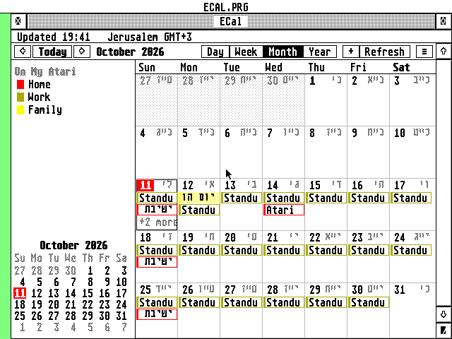

# ECal


A calendar for the Atari ST, STE, TT and Falcon: a GEM desk accessory that syncs with iCloud and any
CalDAV server.

**Highlights**

- **Like the Mac's Calendar:** day, week, month and year views, each calendar in its own colour.
- **iCloud and CalDAV** (Fastmail, Nextcloud, Radicale...), synced both ways.
- **Subscriptions** to `.ics` feeds, and calendars kept on the Atari.
- **Every repeat** RFC 5545 has, with "only this one" or "all future ones" edits.
- **Invitations** by name from [EContact](https://github.com/whomper/EContact).
- **Reminders** over any program, and a background sync with the window closed.
- **Modern but Atari:** accessory or program, right-click menus, drag and drop, iconify.
- **Secure:** TLS 1.2 on the TT and Falcon, with the DSP; ST and STE through the Gateway.
- **Hebrew** throughout: right to left, the Israeli keyboard (F10), Hebrew dates and repeats.
- **Time zones, offline, TT RAM and GDOS fonts.**



## Getting started

Download `ECAL-x.y.zip` (or each file) from **[Releases](https://github.com/whomper/ECal/releases/latest)**:

| File | What it is |
|---|---|
| `ECAL.ACC` / `ECAL.PRG` | the accessory, or the same as a program, for every Atari |
| `TLS.OVL`, `CACERT.PEM`, `ROOTS.DAT` | the Direct connection (TT, Falcon), loaded only when used |
| `ECAL.HYP`, `ECAL.REF` | the guide, opened by the Help key |
| `icons/` | ECal's desktop icon ([how](docs/GUIDE.md#the-desktop-icon)) |

1. Copy `ECAL.ACC` to the root of the boot drive, the rest to a folder of its own (it asks where).
2. On an ST or STE, set up the Gateway on a Raspberry Pi ([steps](docs/GUIDE.md#settings)).
3. Reboot, choose **ECal** in the Desk menu; in **Settings...** give the Gateway or tick **Direct
   connection**, and the clock's time zone.
4. **Add account or calendar...** with an [app password](docs/GUIDE.md#app-passwords-icloud-fastmail-yahoo).
5. Press **Help** for the [guide](docs/GUIDE.md).

**Needs:** TOS 1.04 to 4.x, EmuTOS, MagiC or MiNT; ST medium or high, TT or Falcon resolution; 1 MB
(2 MB for big calendars); STinG or MiNTnet. On a 1 MB ST, ECal's accessory or EContact's, not both.
Under TOS, `FOLDR100.PRG` first in `AUTO`; STinG's Delay set to the machine ([why](docs/GUIDE.md#installing)).

Everything ECal does, and how fast: [docs/FEATURES.md](docs/FEATURES.md).

## The Gateway

ECal connects by itself on a Falcon or TT (TLS 1.2, with the DSP) and through
**[AERA-Gateway](https://github.com/whomper/AERA-Gateway)**, a small service on a Raspberry Pi or in Docker,
on an ST or STE: the Gateway makes the secure connections, unpacks answers and trims big feeds. On a
Falcon or TT it is optional. Setting it up: the [Gateway's README](https://github.com/whomper/AERA-Gateway#readme).

## Building

```sh
sudo apt install gcc gcc-m68k-linux-gnu python3 zip   # Debian/Ubuntu; no MiNTLib needed
make                          # binary/: ECAL.ACC, ECAL.PRG, TLS.OVL, CACERT.PEM, ROOTS.DAT
make test                     # the core's unit tests, the fuzz inputs, the gateway's tests
make itest                    # against a local CalDAV server (Radicale)
make dist HCP=/path/to/hcp    # dist/: a release's files and ECAL-x.y.zip
```

Releases, the help file and the icons: [docs/DEVELOPING.md](docs/DEVELOPING.md).

## Source

```
src/      the calendar core: iCalendar, repeats, CalDAV, sync
ui/       the GEM program
common/   shared with the other AERA programs (AERA-Atari)
docs/     the user guide (ECAL.HYP's source); the rest of the tree in DEVELOPING.md
```

## Tests

`make test`: dates, zones, iCalendar, every RFC 5545 repeat example, XML; the rest in [docs/DEVELOPING.md](docs/DEVELOPING.md#tests).

## Licence

GPL version 2 or later, without any warranty ([COPYING](COPYING)). Copyright (C) 2026 AERA | Erez Yaary.
Includes [BearSSL](common/third_party/bearssl) (MIT) and Mozilla's root certificates (MPL 2.0).

---

Part of **AERA** for Atari: [ECal](https://github.com/whomper/ECal) · [EContact](https://github.com/whomper/EContact) · [EMail](https://github.com/whomper/EMail) · [EFTP](https://github.com/whomper/EFTP) · [EHypView](https://github.com/whomper/EHypView) · [ClaudeST](https://github.com/whomper/ClaudeST) · [EWeb](https://github.com/whomper/EWeb) · [EUpdate](https://github.com/whomper/EUpdate) · [EPDF](https://github.com/whomper/EPDF) · 8-bit: [EDOS](https://github.com/whomper/EDOS) · [EFTP_XL](https://github.com/whomper/EFTP_XL) · Gateway: [AERA-Gateway](https://github.com/whomper/AERA-Gateway)
