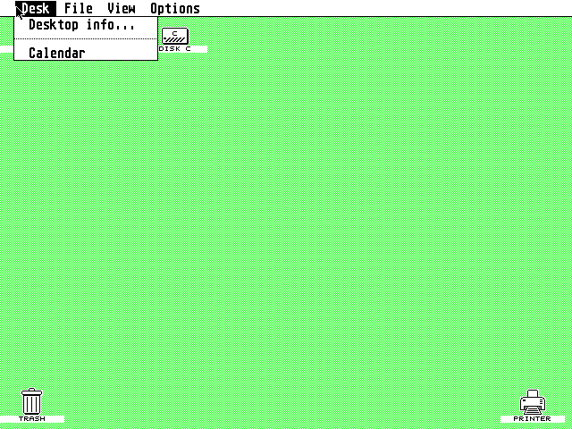
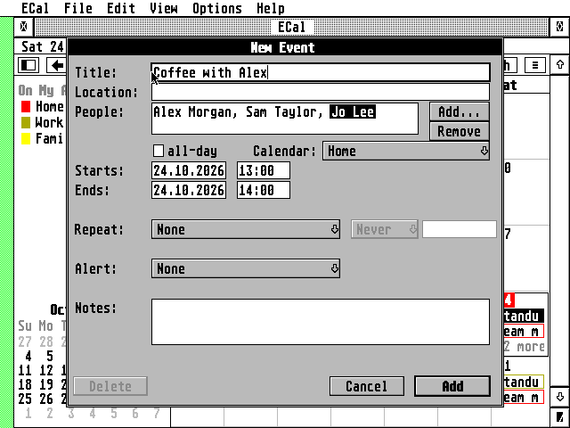

# Calendar

A calendar for the Atari ST, STE, TT and Falcon, written in C for GEM.
It runs as a **desk accessory**, so it opens from the Desk menu over
whatever program you're working in, and it works like the Mac's Calendar:
day, week, month and year views, several calendars in colour, iCloud and
other CalDAV accounts, subscriptions to published calendars, reminders,
time zones, and Hebrew.


- **iCloud** and any **CalDAV** server (Fastmail, Nextcloud, Radicale,
  Synology, Yahoo...): calendars found automatically, events added, changed
  and deleted on the server, changes made elsewhere fetched with ETags so
  only what changed comes over the line
- **Subscriptions**: `webcal://` and `https://` `.ics` feeds (holidays,
  sports, a Google calendar's secret iCal address), refreshed on a schedule
- **On My Atari** calendars, kept only on this computer; `.ics` import
- **Views**: day (with the selected event's details), week, month, year;
  all-day and multi-day events as bars, overlapping events side by side,
  "+3 more" when a day is full
- **Today**: today's date in red everywhere, a red line at the current time,
  a Today button, and the view moves on at midnight
- **Repeating events**: every kind of repeat iCalendar has (RFC 5545:
  yearly to every second, any BYDAY/BYMONTHDAY/BYYEARDAY/BYWEEKNO/BYMONTH/
  BYHOUR/BYMINUTE/BYSECOND, BYSETPOS, WKST, extra dates (RDATE), excluded
  dates and rules (EXDATE, EXRULE)), plus Hebrew-calendar repeats
  (RFC 7529 `RSCALE=HEBREW`, "every year on 12 Tishri"). The Repeat menu
  has the usual ones; **Custom...** builds any rule ("the last Friday of
  every month", "the second Monday of March and September"), or type it
- **One occurrence or the series**: move, change or delete just one
  occurrence of a repeating event, or this and all future ones, as on the
  Mac; changes made on an iPhone to one occurrence or to "this and future"
  show as they should
- **Reminders** that pop up over any program, even with the window closed
- **Time zones**: events keep their zone; with time zone support on, see
  your calendar as it looks from another city. Summer time rules for Israel
  (the Friday before the last Sunday of March), Europe, the Americas,
  Australia and more are built in; others are learned from the calendar data
- **Hebrew**: titles, places and notes in Hebrew, right to left, typed on
  the Israeli keyboard (F10) in every field, like EMail; Hebrew calendar
  names; Hebrew dates (י״ב תשרי תשפ״ז) next to the civil ones
- Keeps a copy of everything on disk: opens at once and works offline
- Runs on TOS 1.04 to 4.x, EmuTOS, MagiC and MiNT, with STinG or MiNTnet,
  in ST high, ST medium, TT and Falcon resolutions; with NVDI the views
  draw several times faster than with TOS's own VDI

## How it reaches the servers

Calendar servers want HTTPS. Like [EMail](https://github.com/whomper/EMAIL),
Calendar gets there one of two ways:

```
ST, STE, any Atari:  Atari (CALST.ACC) --plain HTTP, home LAN--> Raspberry Pi (calgate.py) --HTTPS--> iCloud
Falcon, TT:          Falcon (CALENDAR.ACC, TLS 1.2, RSA on the DSP) ---------------------HTTPS--> iCloud
```

- **Through the Pi.** `gateway/calgate.py` on a Raspberry Pi takes the
  Atari's requests and makes the HTTPS connections. It also does what an
  8 MHz machine finds hard: it unpacks compressed answers, keeps
  connections to the servers open, and cuts multi-megabyte subscription
  feeds down to the months you keep. See [gateway/README.md](gateway/README.md).
- **Falcon mode.** On a Falcon (or a TT), Calendar does TLS 1.2 itself
  with [BearSSL](https://bearssl.org/), and the DSP56001 checks the servers'
  RSA signatures (about 0.1 s each), as in EMail.

## The files

| File           | For                                                               |
|----------------|-------------------------------------------------------------------|
| `CALENDAR.ACC` | Falcon and TT: the accessory with Falcon mode (TLS, DSP); also works through the Pi |
| `CALST.ACC`    | ST and STE: the same accessory without TLS (150 KB smaller), through the Pi |
| `CALENDAR.PRG` | the same as CALENDAR.ACC, to start from the desktop instead       |
| `CACERT.PEM`, `ROOTS.DAT` | the root certificates for Falcon mode                  |

## Getting started

1. Copy `CALENDAR.ACC` (Falcon/TT) or `CALST.ACC` (ST/STE, renamed to
   `CALENDAR.ACC` or not) into the root of your boot drive, e.g. `C:\`.
   For Falcon mode, make a folder `C:\CALENDAR` and put `CACERT.PEM` and
   `ROOTS.DAT` in it. (Calendar keeps its own files there too.)
2. For an ST, set up the gateway on a Raspberry Pi:
   `sudo gateway/install.sh` (see [gateway/README.md](gateway/README.md)).
3. Reboot, choose **Calendar** in the Desk menu, and add your iCloud
   account with an [app-specific password](https://support.apple.com/en-us/102654).

The [user guide](docs/GUIDE.md) describes the rest.

 

## Building

```
sudo apt install gcc-m68k-linux-gnu      # Debian/Ubuntu
make                                     # CALENDAR.ACC, CALENDAR.PRG, CALST.ACC
```

The program is freestanding (`atari/`, no MiNTLib); `tools/elf2tos.py`
writes the TOS executable. One binary is both the accessory and the
program: the start-up code (`atari/crt0.S`) sees which way TOS started it.
Everything is 68000 code except BearSSL, which is built for the 68030.

**Version numbers.** Every build gets the next number: `make` adds one to
the number in `BUILD` whenever anything is recompiled and puts
`1.1.N` (with the date) into the program (`tools/bump.py`). The About box
shows it, and it's in the User-Agent Calendar sends. Commit `BUILD` with
the changes.

## Source

```
src/      the calendar core, also built on Linux for the tests:
          ctime.c  dates and the Hebrew calendar      tz.c      time zones
          ics.c    iCalendar                          rrule.c   repeat rules
          xml.c    WebDAV answers
          http.c   HTTP/1.1, via the Pi or with TLS   caldav.c  CalDAV
          calstore.c  accounts, caches, sync, saving changes
          (charset, bidi, conn, tls, secret: from EMail)
ui/       the GEM program: window, views, sidebar, event editor, dialogs,
          and field.c, dialogs whose text fields take Hebrew
atari/    TOS runtime from EMail (start-up for accessories added), STinG, DSP
dsp/      the DSP56001 RSA program (from EMail)
gateway/  calgate.py, the Raspberry Pi gateway, and its installer
tests/    unit tests, CalDAV integration tests, Hatari tests
```

## Tests

```
make test                    # the core: dates, Hebrew dates, zones, iCalendar, repeats,
                             # repeat rules with all of RFC 5545's examples, XML, URLs
                             # (218 checks); and the gateway (8 tests)
make itest                   # cal-cli against a real CalDAV server (Radicale): sync,
GATEWAY=1 make itest         # add, rename, move one occurrence, delete one or the
FALCON=1 make itest          # rest, changes from elsewhere, subscriptions, import;
                             # direct, through calgate, and with Calendar's own TLS
                             # (pip install radicale)
```

`tests/hatari/` runs the real accessory in the
[Hatari](https://hatari.tuxfamily.org/) emulator with
[EmuTOS](https://emutos.sourceforge.io/), driven by Xvfb and xdotool:

```
tests/hatari/acc_test.py WORK etos512us.img                # as a desk accessory, Falcon
tests/hatari/edit_test.py WORK etos512us.img --machine st --acc CALST.ACC
                                                           # add, Hebrew title, find, delete,
                                                           # one occurrence, custom repeats
tests/hatari/net_test.py WORK etos512us.img                # an ST syncing through calgate
tests/hatari/net_test.py WORK etos512us.img --falcon-mode  # TLS on the Falcon, RSA on the DSP
tests/hatari/ui_tour.py WORK etos512us.img                 # screenshots of every view
```

The network tests use EMail's FAKESTNG.PRG (`make -C tools/fakesting`),
which carries the emulated Atari's TCP over its serial port; it's for the
emulator only, never for a real Atari.
