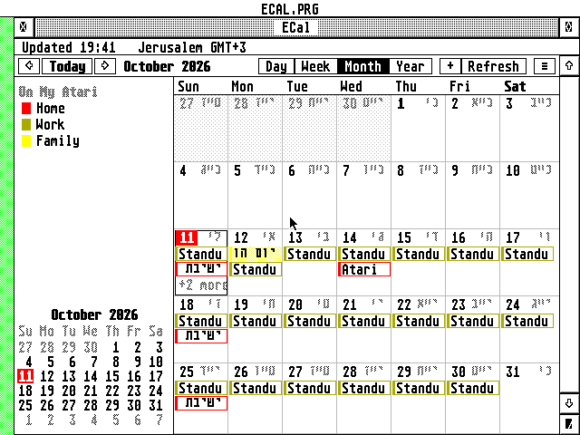

# ECal


A calendar for the Atari ST, STE, TT and Falcon: a GEM desk accessory that syncs with iCloud and any
CalDAV server.

**Highlights**

- **Like the Mac's Calendar:** day, week, month and year views; iCloud and other CalDAV calendars with
  two-way sync, `.ics` subscriptions and calendars kept only on the Atari, each in its own colour.
- **Modern but Atari:** a desk accessory that opens over whatever program you're working in, or a
  program; right-click menus, drag and drop, iconify, help in EHypView or ST-Guide.
- **Secure:** TLS 1.2 on the Falcon and TT, with RSA and the elliptic curves on the DSP; ST and STE through a Raspberry Pi
  gateway.
- **Hebrew** throughout: right-to-left text, the Israeli keyboard (F10), Hebrew dates and
  Hebrew-calendar repeats.
- **Every repeat:** all of RFC 5545's rules, with "only this one" or "all future ones" edits.
- **Invitations:** invite people by name from [EContact](https://github.com/whomper/EContact) (or
  its contacts file when it isn't loaded) or by address; iCloud sends the invitations, and their
  answers are kept.
- **Always to hand:** reminders over any program, time zones, and its own copy on disk, so it works
  offline.
- **Makes the most of the machine:** TT RAM when there is some, GDOS fonts, hover tooltips.



## Getting started

Download the latest release from **[Releases](https://github.com/whomper/ECal/releases/latest)**: each
file on its own, or all of them in `ECAL-x.y.zip`.

| File | What it is |
|---|---|
| `ECAL.ACC` | Falcon and TT: the desk accessory with Falcon mode (TLS, DSP); also works through the Pi |
| `ECALST.ACC` | ST and STE: the same accessory without TLS (about 120 KB smaller), through the Pi |
| `ECAL.PRG` | the same as `ECAL.ACC`, to start from the desktop, with a menu bar |
| `CACERT.PEM`, `ROOTS.DAT` | the root certificates for Falcon mode |
| `ECAL.HYP`, `ECAL.REF` | the guide, for EHypView, ST-Guide or HypView, opened by the Help key |
| `ECAL.RSC`, `ECAL.ICN`, `ECALMK.ICN` | ECal's desktop icon, in black and white and 16 colours (shown in 256 colours too); in the zip's `icons/` folder (see the guide's [The desktop icon](docs/GUIDE.md#the-desktop-icon)) |
| `ECAL-x.y.zip` | all of these in one file |

1. Copy `ECAL.ACC` (Falcon, TT) or `ECALST.ACC` (ST, STE; renamed to `ECAL.ACC` or not) to the root
   of your boot drive, e.g. `C:\`.
2. Choose a folder for ECal's own files (its calendars, keys and log): any folder, on any drive.
   For Falcon mode, put `CACERT.PEM` and `ROOTS.DAT` in it. `FOLDER=` in the settings file, which is
   always `ECAL.INF` in the root of the boot drive, says where the folder is: starting `ECAL.PRG`
   from the folder writes it, and the accessory asks the first time you open it (**Locate...**, or
   **Use C:\ECAL** to have it make that one).
3. On an ST or STE, set up the gateway on a Raspberry Pi from
   [AERA-Gateway](https://github.com/whomper/AERA-Gateway)'s own repository (see
   [gateway/README.md](gateway/README.md)). On a new Pi, every AERA gateway for your Atari in one
   line, ECal's among them (e-mail's only with `--mail`):

   ```
   sudo apt install -y git && git clone https://github.com/whomper/AERA-Gateway ~/AERA-Gateway && ~/AERA-Gateway/update-pi.sh --allow ATARI_IP
   ```

   Or step by step, only ECal's:

   ```
   sudo apt install -y git                  (Raspberry Pi OS Lite only)
   git clone https://github.com/whomper/AERA-Gateway
   cd AERA-Gateway
   ./update-pi.sh
   sudo gateway/aera-gateway install dav --allow ATARI_IP
   ```

   `ATARI_IP` is the Atari's address (e.g. 192.168.1.x): only it may use the gateway. Either way the
   install prints the address to type into ECal.
   - To update it to AERA-Gateway's latest release: `cd ~/AERA-Gateway && ./update-pi.sh`.
   - To check it: `gateway/aera-gateway status` in that folder, or http://PI_IP:8180/ in a browser.
4. Reboot and choose **ECal** in the Desk menu. Open **Settings...** (Control and comma, or the ≡ menu
   at the right of the toolbar):
   - **Connection**: type the Pi's IP address (`PI_IP`, e.g. 192.168.1.x, not its name) and port 8180
     into **Pi gateway**; or, on a Falcon or TT, tick **Falcon mode**.
   - **Time zones**: set the zone the Atari's clock is in.
5. Add your iCloud account with **Add account or calendar...** (the ≡ menu, or **File** in
   `ECAL.PRG`) and an [app-specific password](https://support.apple.com/en-us/102654); your Apple ID's
   own password won't work.
6. Copy `ECAL.HYP` and `ECAL.REF` into ECal's folder or your viewer's help folder (e.g. `C:\GUIDES\`),
   and press **Help** in ECal for the guide (EHypView, ST-Guide or HypView must be running).

**Updating:** copy the new release's files over the old ones (the accessory, `ECAL.PRG`, the guide,
and for Falcon mode the certificates) and reboot. The settings, passwords and calendars stay as they
are.

The [user guide](docs/GUIDE.md) describes the rest.

**Needs:** TOS 1.04 to 4.x, EmuTOS, MagiC or MiNT; ST medium, ST high, TT or Falcon resolution (not ST
low); 1 MB of RAM, where `ECALST.ACC` runs beside STinG (2 MB or more for big calendars); STinG or
MiNTnet. On an ST or STE, a Raspberry Pi (or any Debian or Ubuntu computer) for the gateway; Falcon mode
needs a Falcon or TT. On a 1 MB ST, `ECALST.ACC` or EContact's `ECONTST.ACC`, not both: together
they leave TOS no memory and the ST stops at boot. Run the other as a program.

**Under TOS, put Atari's `FOLDR100.PRG` first in `AUTO`**, renamed for more room (`FOLDR400.PRG`).
TOS keeps an entry in a small internal pool for every folder a program or accessory has looked
into, and halts with "OUT OF INTERNAL MEMORY" when it runs out; FOLDRxxx makes the pool bigger.

**With STinG, set the Delay in `STING.CPX` to suit the machine:** 10 on a Falcon or TT, 25 to 50 on
an ST, as STinG's manual says. STinG looks at the network card that often, so it sets the speed of
every STinG program: on Erez's Falcon with a NetUSBee, Delay 10 took EFTP's downloads from 40 to
75 KB/s.

## How it reaches the servers

Calendar servers want HTTPS. Like [EMail](https://github.com/whomper/EMail), ECal gets there one of two
ways:

```
ST, STE:     Atari (ECALST.ACC) --plain HTTP, home LAN--> Raspberry Pi (ecalgate.py) --HTTPS--> the server
Falcon, TT:  Atari (ECAL.ACC, TLS 1.2, RSA, curves on the DSP) ------------------------HTTPS--> the server
```

- **Through the Pi.** `gateway/ecalgate.py` on a Raspberry Pi takes the Atari's requests and makes the
  HTTPS connections. It also does what an 8 MHz machine finds hard: it unpacks compressed answers,
  keeps connections to the servers open, and cuts multi-megabyte subscription feeds down to the months
  you keep. Any Atari can use it, a Falcon too, to save time.
- **Falcon mode.** On a Falcon (or a TT), ECal does TLS 1.2 itself with
  [BearSSL](https://bearssl.org/), and the DSP56001 checks the servers' RSA signatures (about 0.1 s
  each), as in EMail, and does the elliptic curves: the key exchange (X25519: two steps of about 0.07 s
  each, 0.4 s on a 16 MHz 68030) and ECDSA certificates (P-256, P-384).

The gateway's own README, with its options and how to keep it private:
[gateway/README.md](gateway/README.md).

## What it does

- **iCloud** and any **CalDAV** server (Fastmail, Nextcloud, Radicale, Synology, Yahoo...): calendars
  found automatically; events added, changed and deleted on the server; changes made elsewhere fetched
  with ETags, so only what changed comes over the line.
- **Subscriptions**: `webcal://` and `https://` `.ics` feeds (holidays, sports, a Google calendar's
  secret iCal address), refreshed on a schedule.
- **On My Atari** calendars, kept only on this computer; `.ics` import.
- **Invitations**: an `.ics` invitation (handed over by EMail, opened on the desktop or with File >
  Import .ics...) fills the New Event dialog; saved, it keeps its UID and its organiser, so a later
  update of the same invitation finds the event. Files with several events are imported after asking.
- **Views**: day (with the selected event's details), week, month and year; all-day and multi-day
  events as bars, overlapping events side by side, "+3 more" when a day is full.
- **Today** in red everywhere, a red line at the current time, a **Today** button, and the view moves
  on at midnight.
- **Repeating events**: every kind of repeat iCalendar has (RFC 5545: yearly to every second, any
  BYDAY/BYMONTHDAY/BYYEARDAY/BYWEEKNO/BYMONTH/BYHOUR/BYMINUTE/BYSECOND, BYSETPOS, WKST, extra dates
  (RDATE), excluded dates and rules (EXDATE, EXRULE)), plus Hebrew-calendar repeats (RFC 7529
  `RSCALE=HEBREW`, "every year on 12 Tishri"). The **Repeat** menu has the usual ones; **Custom...**
  builds any rule ("the last Friday of every month", "the second Monday of March and September"), or
  type it in.
- **One occurrence or the series**: move, change or delete just one occurrence of a repeating event,
  or this and all future ones, as on the Mac. Changes made on an iPhone to one occurrence or to "this
  and future" show as they should.
- **Reminders** pop up over any program, even with the window closed.
- **Syncs in the background**: with its window closed the accessory brings the calendars up to date a
  little at a time while the machine is idle, fetching only what changed, so new events and their
  reminders arrive without opening ECal.
- **Time zones**: events keep their zone; with time zone support on, see your calendar as it looks
  from another city. Summer time rules for Israel (the Friday before the last Sunday of March),
  Europe, the Americas, Australia and more are built in; others are learned from the calendar data.
- **Hebrew**: titles, places and notes in Hebrew, right to left, typed on the Israeli keyboard (F10)
  in every field, as in EMail; Hebrew calendar names; Hebrew dates (י״ב תשרי תשפ״ז) next to the civil
  ones.
- **Cancelled events** are left out: cancelled by the organiser, titled "Canceled:" (Outlook,
  Exchange), or invitations you declined.
- **Find** (^F) through titles, places and notes.
- **Tooltips**: rest the mouse on an event to see its title and times.
- **Fonts**: the system font or any monospaced GDOS font (NVDI, SpeedoGDOS), picked in the family's
  Font dialog; twelve calendar colours, the same in 16 and 256 colours. With NVDI the views draw
  several times faster than with TOS's own VDI.
- **The calendar list** hides with a toolbar button (or ⇧^S), leaving the window to the calendar.
- **Offline**: ECal keeps a copy of everything on disk, so it opens at once, shows today before it
  syncs, and works offline (**Work offline** in the Options or ≡ menu, as in EMail).
- **TT RAM**: on a TT or an accelerated Falcon the program and its memory go to TT/Fast RAM, leaving
  ST RAM free; the About box says so.

## Performance: Pi, ST and Falcon

Where the work happens decides the speed. Figures are from the emulated Falcon (16 MHz 68030) and from
counting 68030 instructions; a real iCloud sync also depends on the network and on how many events
change.

| | ST through the Pi | Falcon through the Pi | Falcon mode, DSP | Falcon mode, no DSP |
|---|---|---|---|---|
| TLS, certificates | on the Pi | on the Pi | 68030 + DSP | 68030 alone |
| New secure connection | none on the Atari | none on the Atari | a few seconds once, then ~0.7 s (resumed) | slower: the RSA check runs on the 68030 |
| RSA signature check | — | — | ~0.1 s | several times longer |
| Key exchange (X25519) | — | — | ~0.15 s | ~0.8 s |
| Decrypting answers | — | — | ~200 instructions a byte | the same |
| Compressed answers | unpacked by the Pi | unpacked by the Pi | unpacked by ECal, ~10 instructions a byte | the same |
| Big subscription feeds | trimmed by the Pi to the months kept | trimmed by the Pi | parsed whole by ECal | parsed whole |

- **Through the Pi** is the fastest way for any Atari: the Atari only sends and reads plain HTTP on
  the home network, and the Pi keeps the connections to the servers open. On an 8 MHz ST, drawing and
  reading the calendar data take most of the time, not the network.
- **Falcon mode** needs no Pi. After the first connection each request costs well under a second;
  most of a first sync goes into the first handshake and into decrypting what comes back, which
  compression keeps small. Saving an event takes about a second.
- **The DSP** only speeds up the handshake at the start of each new connection (the certificate checks
  and the key exchange: 2.1 s of work became 1.3 s in the emulated Falcon); with session resumption
  there are few of those, so it matters most for the first sync after starting ECal.
- On a TT or an accelerated Falcon, running in TT/Fast RAM makes everything ECal does itself faster.

In Falcon mode the 68030 decrypts every byte itself and doesn't read from STinG while it does, so
receiving and decrypting take turns: the speed is about 1/(1/network + 1/decrypt). EMail measured
13 KB/s that way against 37 KB/s through the Pi. Faster decryption is all ECal can do about it
(table-based AES and the fastest GHASH, 16 KB reads, long copies on the 68030); a bigger TCP receive
window in STinG's own configuration lets the two overlap. With **Write a log** on, every line of
`ECAL.LOG` starts with the time of day to the hundredth of a second, so you can see where a sync spends
its time.

## Building

```sh
sudo apt install gcc gcc-m68k-linux-gnu python3 zip   # Debian/Ubuntu; no MiNTLib needed
make                          # binary/ECAL.ACC, ECAL.PRG, ECALST.ACC, CACERT.PEM, ROOTS.DAT
make test                     # the core's unit tests on this computer, the fuzz inputs, the gateway's tests
make itest                    # against a local CalDAV server (Radicale)
make help HCP=/path/to/hcp    # binary/ECAL.HYP from docs/GUIDE.md (hcp: common/tools/build-hcp.sh)
make dist HCP=/path/to/hcp    # dist/: a release's files, each on its own and in ECAL-x.y.zip
make icons                    # icons/, ui/icon*.h, docs/icon*.png: ECal's icon (committed),
                              # from common/icons/ECAL.txt
```

The program is freestanding (no MiNTLib): the C library and the TOS runtime are in `common/atari/`,
and `common/tools/elf2tos.py` writes the TOS executable. One binary is both the accessory and the
program: the start-up code (`common/atari/crt0.S`) sees which way TOS started it. Everything is 68000
code except BearSSL, which is built for the 68030.

`binary/` and `dist/` are what make builds; they are never committed, and a build changes no tracked
file.

**Versions and releases.** `VERSION` holds the last release, major.minor (e.g. 2.10), and the build
never changes it. Every build shows it as it is in the About box and the User-Agent ECal sends. Only
releases leave the build machine. To release: `tools/bump.py`, commit and push, then run
the Release workflow (**Actions > Release > Run workflow**, on `main`) with what is new:
[`.github/workflows/release.yml`](.github/workflows/release.yml) tags the commit `v2.11`, tests, builds
the programs and the help file, and publishes them as a GitHub Release with those notes. Pushing a tag
`v2.11` made with `git tag -a` does the same, with the tag's message as the notes.

## Source

```
src/      the calendar core, also built on Linux for the tests:
          ics.c       iCalendar               rrule.c    repeat rules
          xml.c       WebDAV answers          inflate.c  compressed answers
          http.c      HTTP/1.1, via the Pi or with TLS
          caldav.c    CalDAV                  calstore.c accounts, caches, sync, saving changes
ui/       the GEM program: window, views, sidebar, event editor, dialogs, fonts, About box,
          and field.c, dialogs whose text fields take Hebrew
atari/    plat_tos.c: files, folders and time on GEMDOS
common/   code shared with the other AERA programs (from AERA-Atari): the TOS runtime and
          C library, STinG, TLS and connections, BearSSL, the DSP RSA program, charsets,
          bidi, dates and the Hebrew calendar (ctime.c), time zones (tz.c), passwords,
          GEM building blocks (menus, alerts, help, AV, iconify), build tools
gateway/  the Raspberry Pi gateways (ecalgate.py is ECal's) and aera-gateway, their installer:
          a copy of AERA-Gateway's
tests/    unit tests, fuzz targets, CalDAV integration tests, Hatari tests
tools/    bump.py (a release), guide2stg.py (the help file), icon/ (the icons),
          sync-common.sh (common/ from AERA-Atari), sync-gateway.sh (gateway/ from AERA-Gateway)
docs/     the user guide (GUIDE.md, the source of ECAL.HYP) and its pictures
```

## Tests

```
make test                    # the core: dates, Hebrew dates, zones, iCalendar, repeats,
                             # repeat rules with all of RFC 5545's examples, XML, URLs
                             # (305 checks); the fuzz inputs again (tests/fuzz/seeds,
                             # and found/: what once broke a parser); the gateway's tests
make fuzz                    # the CalDAV answers, iCalendar, repeat rules, XML and
                             # inflate from libFuzzer (clang), FUZZTIME seconds each
make itest                   # cal-cli against a real CalDAV server (Radicale): sync,
GATEWAY=1 make itest         # add, rename, move one occurrence, delete one or the
FALCON=1 make itest          # rest, changes from elsewhere, subscriptions, import;
                             # direct, through ecalgate, and with ECal's own TLS
                             # (pip install radicale)
```

`tests/hatari/` runs the real accessory in the [Hatari](https://hatari.tuxfamily.org/) emulator with
[EmuTOS](https://emutos.sourceforge.io/) 1.4, driven by Xvfb and xdotool. The machine is one of the
family's test machines from `common/tools/machines.py`, named with `--machine`: `ST` (Erez's 1040 ST,
4 MB) and `ST-1` (1 MB), each with `:mono` or `:med`, for ECALST.ACC; `TT` and `Falcon` (`:16` or
`:256` colours) for ECAL.ACC and ECAL.PRG. Each rig has a default, and prints the machine and TOS it
ran on. An ST has no clock, so the rigs set its date and time at boot (`C:\AUTO\CLOCK.PRG`), as you
would from the Control Panel:

```
tests/hatari/acc_test.py WORK [--machine M]       # as a desk accessory (Falcon)
tests/hatari/acc_files.py WORK [--machine M] [--run quiet|sync|falcon]
                                                  # the accessory's disk access, job by job,
                                                  # from Hatari's GEMDOS trace (ST-1:mono)
tests/hatari/font_acc.py WORK [--machine M] [--prg] [--font-id N]
                                                  # a GDOS font chosen: the window redraws in
                                                  # it, and opens again (Falcon; skipped
                                                  # without a GDOS)
tests/hatari/edit_test.py WORK [--machine M]      # add, Hebrew title, find, delete, one occurrence,
                                                  # custom repeats (Falcon; on an ST up to delete)
tests/hatari/alarm_test.py WORK [--machine M]     # reminders from ALARMS.IDX at boot (Falcon)
tests/hatari/net_test.py WORK [--machine M]       # syncing through ecalgate (ST)
tests/hatari/net_test.py WORK --falcon-mode       # TLS on the Falcon, RSA and X25519 on the DSP
tests/hatari/stop_test.py WORK [--machine M]      # Esc stops a server that says nothing (ST)
tests/hatari/quiet_test.py WORK [--machine M]     # make profile first: the accessory's quiet
                                                  # start, timed between event calls (Falcon)
tests/hatari/bgsync_test.py WORK [--machine M] [--falcon-mode]
                                                  # make profile first: a background refresh
                                                  # with the window closed, timed (Falcon)
tests/hatari/mem_test.py WORK [--machine M] [--falcon-mode] [--cals 3] [--events 500] [--boots N]
                                                  # make profile first: the accessory's memory
                                                  # (heap peak, MEMKB=) as calendars come new
tests/hatari/esc_test.py WORK [--machine M]       # Esc and Undo cancel dialogs and alerts, and
                                                  # nothing is written (Falcon)
tests/hatari/people_test.py WORK [--machine M] [--acc]
                                                  # inviting from EContact (PEOPLE), its latest
                                                  # release (Falcon)
tests/hatari/invite_test.py WORK [--machine M] [--acc]
                                                  # an .ics invitation by VA_START: the New
                                                  # Event dialog filled, saved with its UID
tests/hatari/peoplefile_test.py WORK [--machine M] [--acc] [--econtact]
                                                  # EContact's CONTACTS.TXT with EContact not
                                                  # loaded: names, Add...; with it, never read
tests/hatari/notes_test.py WORK [--machine M] [--acc]
                                                  # notes read from the cache when wanted:
                                                  # Find, the details, saved with an edit
tests/hatari/field_test.py WORK [--machine M] [--acc]
                                                  # fields hold more than they show (5.4):
                                                  # a long title, ^C ^V, a long address
tests/hatari/title_test.py WORK [--machine M]     # the toolbar's title fits ("18-24 Oct", not
                                                  # "18-24 Oct 202"), each view (Falcon)
tests/hatari/twin_test.py WORK [--machine M]      # ECAL.PRG and ECAL.ACC on one machine
                                                  # (EmuTOS: its desktop is clicked)
tests/hatari/help_test.py WORK [--machine M]      # the Help key (make fakeguide first; Falcon)
tests/hatari/hypview_test.py WORK                 # the guide in EHypView's latest release (make
                                                  # help first): Falcon:16, Falcon:256, TT:mono
tests/hatari/ui_tour.py WORK [--machine M]        # screenshots of every view (Falcon)
TZ=America/New_York tests/hatari/docs_shots.py WORK --update
                                                  # the screenshots in docs/ (Falcon:16, ST:mono,
                                                  # EmuTOS), and docs/help/WINDOW.IMG
```

Which machines a change passes (the family's guidelines): the ECALST.ACC rigs on `ST` and `ST-1`, in
mono and medium resolution; the others on `TT` and `Falcon`; what draws also on `Falcon:256`.
On `ST-1` with the network the desktop must still start beside ECALST.ACC and FAKESTNG; ECal's log
says how much memory was free at boot and how much the accessory took. `make STACKPROBE=1` builds
the programs to report the least stack left untouched (`STACKFREE` in Hatari's log), which sets the
ST edition's stack (`ST_STACK` in the Makefile).

The network tests use the family's `FAKESTNG.PRG`, which carries the emulated Atari's TCP over its
serial port to `serial_bridge.py` (both in `common/tools/fakesting`, started by `machines.py`); it's
for the emulator only, never for a real Atari.

A test that needs another AERA program (EContact, EHypView) uses that program's latest release, what
you run, fetched with `common/tools/getrelease.py`; the test prints which release it used.

## Licence

ECal is free software: you can redistribute it and/or modify it under
the terms of the GNU General Public License as published by the Free
Software Foundation, either version 2 of the License, or (at your option)
any later version. It is distributed in the hope that it will be useful,
but WITHOUT ANY WARRANTY; without even the implied warranty of
MERCHANTABILITY or FITNESS FOR A PARTICULAR PURPOSE. See [COPYING](COPYING).

Copyright (C) 2026 AERA | Erez Yaary.

It includes, under their own licences (compatible with the GPL):

- [BearSSL](common/third_party/bearssl) by Thomas Pornin: MIT licence
  ([LICENSE.txt](common/third_party/bearssl/LICENSE.txt))
- `CACERT.PEM`, the root certificates for Falcon mode, from Mozilla's CA
  list (Mozilla Public License 2.0)

---

Part of **AERA** for Atari: [ECal](https://github.com/whomper/ECal) · [EContact](https://github.com/whomper/EContact) · [EMail](https://github.com/whomper/EMail) · [EFTP](https://github.com/whomper/EFTP) · [EHypView](https://github.com/whomper/EHypView) · [ClaudeST](https://github.com/whomper/ClaudeST) · [EWeb](https://github.com/whomper/EWeb) · [EUpdate](https://github.com/whomper/EUpdate) · 8-bit: [EDOS](https://github.com/whomper/EDOS) · [EFTP_XL](https://github.com/whomper/EFTP_XL) · Pi: [AERA-Gateway](https://github.com/whomper/AERA-Gateway)
