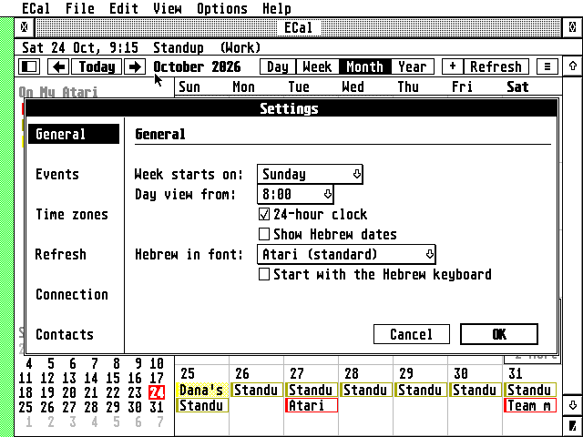
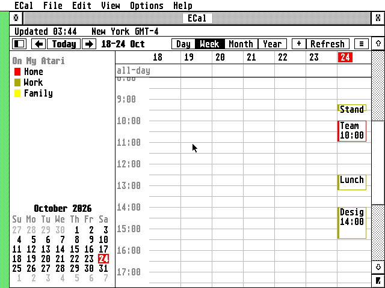

# ECal - user guide

## Installing

ECal is a desk accessory: TOS loads it at boot from the root of the
boot drive, and it waits in the Desk menu as **ECal** until you
choose it.

| Your Atari        | Copy to `C:\`    | Connects                        |
|-------------------|------------------|---------------------------------|
| Falcon, TT        | `ECAL.ACC`       | by itself (Falcon mode) or through the Pi |
| ST, STE, Mega ST  | `ECALST.ACC`     | through the Raspberry Pi gateway |

The settings are in `ECAL.INF` in the root of the boot drive, next to
the accessory, where it can always find them. Everything else is in
ECal's folder, which can be anywhere, on any drive and as deep as you
like: `FOLDER=` in `ECAL.INF` says where.

```
C:\ECAL.ACC
C:\ECAL.INF               settings, accounts, calendars; FOLDER= names the folder
F:\...\ECAL.APP\          ECal's folder (C:\ECAL\ unless you choose another):
    ECAL.PRG              the program, if you use it
    ECAL.KEY              the key the passwords in ECAL.INF are encrypted with
    CACHE\                a copy of every calendar
    ECAL.FNT              which GDOS fonts are fixed-width (made by Font...)
    CACERT.PEM            Falcon mode: root certificates (copy them here)
    ROOTS.DAT             Falcon mode: the same, decoded ahead of time
    ECAL.LOG              with Write a log on
    CRASH.LOG             what happened, if ECAL.PRG ever crashes
```

- **`ECAL.PRG`** is the same program, to start from the desktop or a
  shell; it ends when its window closes. It has a menu bar (**File**,
  **Edit**, **View**, **Options**, **Help**) with the commands of the
  accessory's ≡ menu. It uses the folder it was started from as ECal's
  folder and writes that into `FOLDER=`, so starting it once from your
  folder is all it takes for the accessory to find it too.
- **Both installed:** they share the settings and the calendars, and
  never work on them at once. While `ECAL.PRG` runs, the accessory stands
  aside: ECal in the Desk menu brings the program's window to the front,
  and the program, not the accessory, refreshes and shows the reminders.
  When the accessory is next opened, it reads again whatever the program
  changed. Under MagiC or MiNT, where the accessory runs beside the
  programs, starting `ECAL.PRG` opens the accessory instead.
- **The accessory** reads `FOLDER=` when it starts. If it's empty, or
  the folder isn't there any more, the first time you open ECal it asks
  where the folder is: **Locate...** opens the file selector (pick any
  file in the folder), or use `C:\ECAL`. The answer is kept in
  `FOLDER=`.
- Settings from an older ECal, in `C:\ECAL\ECAL.INF` or in the
  program's folder, are copied to the root the first time.

**Memory.** The accessory takes its working memory once, at boot (an
accessory can't safely take more later): 1.5 MB on a Falcon or TT,
256 KB on an ST, never more than half of what's free. A 1 MB ST runs it;
with big calendars, 2 MB or more is better. `HEAPKB=` in ECAL.INF
sets another amount, in kilobytes. When the memory runs out while the
calendars are read, ECal says so when you open it, and which calendar is
missing events: give it more, or keep fewer days (Settings > Refresh).

**TT RAM.** On a TT, or a Falcon with an accelerator's Fast RAM, TOS
loads ECal into TT RAM, and its memory comes from there too, leaving ST
RAM to the programs that need it. The accessory then takes 4 MB (still
at most half of what's free). The About box says "TT RAM" when ECal runs
there, and with **Write a log** on, the log's first line says where the
program and its memory are.

**The clock.** ECal's "today" is the Atari's clock, so set it (an ST
without a clock card starts each day at an old date; the Control Panel or
a clock program at boot sets it). In Settings > Time zones, tell ECal which time
zone the clock is in.

## Settings

Options > **Settings...** (^,), or the ≡ menu (the button at the right
of the toolbar) in the accessory. As
in EMail, the sections are listed on the left; click one for its
settings. **OK** keeps the changes in all of them, **Cancel** none.



- **General**: the first day of the week (Sunday, Monday or Saturday),
  the first hour the day and week views show, the 24-hour clock, Hebrew
  dates next to the civil ones, which character set your font has
  Hebrew in, and whether ECal starts with the Hebrew keyboard.
- **Events**: how long a new event lasts and the alert it starts with;
  **Show alerts** turns all reminders on or off.
- **Time zones**: see [Time zones](#time-zones).
- **Refresh**: how often every calendar is brought up to date, and
  whether opening the window does it. **Also with the window closed**
  (the accessory only, on at first) refreshes them in the background
  while you work in another program: once after it has read the
  calendars at start, then as often as **Refresh all** says. It works a
  little at a time while the machine is idle and fetches only what
  changed; problems show in the calendar list the next time you open
  ECal. (Through the Pi gateway that costs the Atari next to nothing;
  in Falcon mode each new connection's TLS handshake holds the machine
  for a second or two, so it starts one only while you aren't working.)
  **Read calendars** (the accessory only): when it reads the calendars
  kept on disk: **After a minute** (as at first), at once (**At start**),
  after five minutes, or only **When opened**; its reminders come from
  the start either way (see [Reminders](#reminders)). **Keep on this Atari**: how many
  days back and ahead ECal keeps. It starts with 0 and 400: nothing from
  before today is copied, and repeating events show from today on. Fewer use
  less memory and sync faster.
- **Connection**: how ECal reaches the servers:
  - **Pi gateway**: the Pi's address and port (8180). Set the Pi up
    with `gateway/aera-gateway install dav`; see [gateway/README.md](../gateway/README.md).
    Any Atari can use it, and a Falcon can too, to save time.
  - **Falcon mode**: ECal makes the secure connections itself. Needs a
    68030 (Falcon or TT), `ECAL.ACC`, and `CACERT.PEM` and `ROOTS.DAT` in
    `C:\ECAL\`. **Check certificates on the DSP** lets the Falcon's
    DSP56001 do the RSA arithmetic (much faster than the 68030).
  - A server on your home network that speaks plain `http://` (a Radicale
    or Nextcloud without TLS) needs neither.
  - **Write a log**: `ECAL.LOG` in ECal's folder, the conversation
    with the servers (passwords left out) when something doesn't work.
    Every line starts with the time of day ("14:05:31.27"), so the log
    shows where a sync spends its time.
  - **Speed in Falcon mode**: the 68030 decrypts every byte and doesn't
    read from the network meanwhile, so the two take turns (about
    13 KB/s in EMail's measurements, against 37 KB/s through the Pi). A
    bigger TCP receive window in STinG's configuration lets them overlap.

**Font...** in the Options menu (or the ≡ menu) picks the font for the window, as in EMail: the
system font in its two sizes, and with a GDOS (NVDI, SpeedoGDOS,
FontGDOS) its monospaced fonts in any size they come in. The first time
the selector opens, ECal measures every font to find the fixed-width
ones (the info line counts them: "Looking for fixed-width fonts: 12 of
240...") and keeps the answers in `ECAL.FNT`, so later openings are
quick; only fonts added since are measured. For the system font and
bitmap fonts, pick the Hebrew sample that reads correctly so ECal knows
where the font keeps its Hebrew letters. A vector font (Speedo,
TrueType, Type 1) is asked through NVDI 5 for its own Hebrew letters;
when it has none, or there is no NVDI 5, they are drawn in the system
font in the same cells, and the dialog's Type line says which.
Dialogs and menus stay in the system font.

## Adding calendars

File > **Add account or calendar...** (in the accessory, the ≡ menu):

- **iCloud**: your Apple ID and an **app-specific password**. Make one at
  [appleid.apple.com](https://appleid.apple.com) > Sign-In and Security >
  App-Specific Passwords; your normal password won't work. ECal finds
  all your iCloud calendars, with their colours. The password shows as
  `*****`; click the eye beside it to see what you typed, as in EMail.
- **Other CalDAV account**: the server's address and your login, e.g.
  `https://caldav.fastmail.com/`, `https://cloud.example.org/remote.php/dav`
  (Nextcloud), `https://caldav.calendar.yahoo.com`. The address of one
  calendar works too.
- **Subscribe to a published calendar**: a `webcal://` or `https://`
  address of an `.ics` file: public holidays, a sports team, a school, or a
  Google calendar (Google's CalDAV needs an OAuth sign-in ECal can't do,
  but every Google calendar has a "Secret address in iCal format" in its
  settings). Subscriptions are read-only and refresh on their own schedule.
- **On My Atari**: a calendar kept only on this computer. Right-click it
  to import an `.ics` file into it.

The calendars appear on the left, under their accounts. Click one to show
or hide it; double-click for its name, colour (twelve to choose from) and
whether its alerts show; right-click for more (show only this one, refresh, import,
unsubscribe). Right-click an account to refresh it, change its settings or
delete it from the Atari (nothing is deleted on the server).

## The window



The toolbar: the first button hides the calendar list on the left, so
the window is all calendar (click it again, or Shift+^S, to bring it back);
**‹ Today ›** move back, to today and forward; then the
period's name (double-click it to go to a date); **Day Week Month Year**;
**+** a new event; **Refresh** (with Shift: everything again, from
scratch); **≡** the menu.

- **Month**: each day with its events; all-day and multi-day events as
  bars across the days, the others one line each, "+2 more" when they
  don't fit (click it for the day). Days of other months are grey.
- **Week** and **Day**: hours down the side, all-day events at the top,
  overlapping events side by side. Scroll with the arrows or the slider;
  a red line marks the time now. The day view shows the selected event's
  details on the right when the window is wide enough.
- **Year**: twelve months, days with events in bold. Click a month's name
  for that month, double-click a day for the day.

Today is in red everywhere. The info line under the title shows when
ECal last updated, the selected event, or what it's doing.

A loop at the right of an event's time line marks a repeating event, a
bell one with an alert (when alerts are on for its calendar); in a box
too narrow for them and the time, the time comes first.

Rest the mouse on an event for a moment and a tooltip shows its title and
when it starts and ends. Click an event to select it, double-click to
open it.

**Drag an event** to move it: in the day and week views to another day and
time (it snaps to quarter hours), in the month view and for all-day
events to another day, keeping its time and length. The info line says
where it will go while you drag. A repeating event asks whether to move
only this occurrence or this and all future ones, as the editor does.

Double-click an empty day or hour for a new event there. Right-click an event to open,
duplicate or delete it; right-click a day for a new event or to change
the view.

**Hebrew dates** (View > Hebrew dates, or ≡ > Hebrew dates) show next to each day: the day of the
Hebrew month in each cell, the month's name on its first day, the full
date in day and week views.

As in EMail, the Options menu (and the ≡ menu) has three ticks:

- **Work offline**: no connections at all; the calendars stay as they
  are on the Atari, and Refresh says ECal is offline. The info line says
  "Working offline".
- **Falcon mode (TLS)**: the same as the tick in Settings > Connection.
- **Write a log**: ECAL.LOG, the conversation with the servers.

While the Hebrew keyboard is on, the info line ends with "Hebrew keyboard
(F10)".

Where the AES can iconify windows (MultiTOS, MagiC, XaAES, N.AES), the
window has the iconify button: ECal shrinks to its icon, with today's
date as the title. Reminders still come while it is iconified.

## Events


- **Title**, **Location**, **Notes** take Hebrew: press **F10** for the
  Israeli keyboard (in every text field, as in EMail), F10 again for
  English. Text is laid out right to left when it starts in Hebrew.
- **People**: who is invited (see [Inviting people](#inviting-people)).
- **Starts / Ends**: dates as day.month.year (`12.10.2026`, `12.10`,
  `12/10/26`), times as `9:30`, `930` or `9:30pm`.
- **all-day** for birthdays, holidays, trips.
- **Calendar**: which calendar it goes in (only those you can change).
- **Zone** (with time zone support on): the event's time zone; "Floating"
  for events that happen at the same clock time anywhere.
- **Repeat**: every day, weekday (Sunday to Thursday when the week starts
  on Sunday, Monday to Friday otherwise), week, two weeks, month, year,
  **every year on the Hebrew date** (birthdays, yahrzeits: 12 Tishri every
  year, whatever the civil date), or **Custom...**. The line
  under it says in words what the repeat is ("Every month on the last
  Friday"). **End repeat**: never, on a date, or after a number of times.
- **Custom...**: how often (every *n* days, weeks, months, years, hours,
  minutes), which weekdays, "on the [first/second/third/fourth/last]
  [day/weekday/weekend day/Sunday...]" of the month or year, days of the
  month (`1,15,-1` for the 1st, the 15th and the last), months, hours and
  minutes. At the bottom is the rule itself in iCalendar's words
  (`FREQ=MONTHLY;BYDAY=-1FR`), which you can also type into: anything
  RFC 5545 allows works there (`FREQ=YEARLY;BYMONTH=3;BYDAY=TH`,
  `FREQ=MONTHLY;BYDAY=MO,TU,WE,TH,FR;BYSETPOS=-1`,
  `FREQ=YEARLY;BYWEEKNO=20;BYDAY=MO`...).
- **Alert**: when to remind you. All-day events have "on the day (9:00)"
  and "1 day before (9:00)".

Changing or deleting an occurrence of a repeating event asks whether it's
**only this one** or **this and all future ones**, as on the Mac:

- **Only this one**: that occurrence becomes an exception with its own
  time, title, place or notes; the rest of the series stays. Moved again
  later, it stays one exception. Deleted, it's left out of the series.
- **All future ones**: the series ends before this occurrence and a new
  one starts here with the changes. On the first occurrence, that's the
  whole series.
- Changing the repeat itself applies from the chosen occurrence on.

Cancelled events aren't shown: those the organiser cancelled, those
whose title begins "Canceled:" or "Cancelled:" (as Outlook and Exchange
send them), and invitations you declined.

Events from iPhones, Macs, Outlook and Google with extra dates, excluded
dates or rules, or "this and future" changes show as they should.

ECal keeps what it doesn't edit: other programs' settings, attachments,
exceptions made on an iPhone all stay as they were when it saves an
event, and so do the answers of the people invited.

**Find** (^F) looks through titles, places and notes, from as far back as
ECal keeps to two years ahead.

## Inviting people

**People** in the event lists who is invited, one after another. Someone
in your contacts in [EContact](https://github.com/whomper/EContact) shows
by name, anyone else by address; rest the mouse on a name for a moment to
see the address. Two lines hold six or so; "+3 more" shows the rest, and
« goes back to the start.

- **Add...** asks for a name or an address. An address (or several, with
  commas: `Dana Levi <dana@example.org>, sam@example.net`) is added as it
  is. A name, or part of one, or nothing at all, opens EContact's window
  to pick from, narrowed by what you typed: choose one or more people, or
  a group for everyone in it, and the event comes back with them added.
- Click a name to choose it, or Tab to the list and use the arrow keys;
  **Remove** or Delete takes the chosen one away.

When you save, the people are written into the event with you as the
organiser, and iCloud (or another server that schedules, RFC 6638) emails
them the invitation and later their answers. You are your account's
user name, so it needs to be an address: an Apple ID is. Those you leave
on the list keep their answers when you add or remove someone else.

An invitation from someone else shows who sent it first, marked
"(organizer)", then the others invited; only the organiser can change
who comes. Invitations you declined aren't shown at all.

EContact keeps your contacts, and ECal asks it for the names behind the
addresses (the family's PEOPLE messages; EContact 1.41 or later, loaded
as an accessory or running). Without it, people show by address and are
added by address. **Contacts...** (the File menu in `ECAL.PRG`, the ≡ menu
in the accessory) opens EContact's window.

## From other programs

A desktop such as Thing, jinnee or Gemini, or any program (with the AV
protocol's VA_START), can hand ECal:

- **.ics files**: their events are imported into the only calendar that
  can take them, or into the one you pick;
- **a webcal: address**: Subscribe opens with it filled in.

`ECAL.PRG` takes .ics files the same way when the desktop starts it with
one: install it as the application for `.ICS` and double-click a file.

Under MultiTOS, MagiC or XaAES you can drag .ics files onto ECal's
window too, or text from another program: a new event opens with the
text as its title. Running as an accessory, ECal tells the desktop about
its window, so Thing and the like can drop .ics files on it there too.

## Copy and paste

^C copies the event you chose to the GEM clipboard, as text: its title,
when, where, then its notes (or **Copy** in the event's right-click
menu). In a dialog, ^C copies a field, ^X cuts it and ^V pastes into it,
in Notes the line the cursor is in; a calendar's address or an
app-specific password is easier to paste than to type. Nothing is ever
copied out of a password field.

## Reminders

When an event's alert comes due, ECal beeps and shows it over
whatever program is running, even with its window closed. **Show** opens
the day. Settings > Events > **Show alerts** turns them all off; each calendar has
its own switch too (subscriptions start with theirs off).

The accessory doesn't have to be opened for its reminders, and it
reminds from the moment the desktop is up: it keeps the next eight days'
reminders in `ALARMS.IDX` next to its calendars, and at boot reads only
that. The calendars themselves it reads later, a minute after boot (or
as **Read calendars** in Settings > Refresh says), or when you open it.
It reads them a little at a time, between the moments the program in
front needs the machine, and stops whenever you move the mouse or type,
so the machine never feels slow because of it; then it builds the
reminders again and writes `ALARMS.IDX`. From then on it compares the
clock with them every half minute, which takes no time at all.
An accessory only runs while the program in front waits for GEM (the
desktop and most GEM programs do): during a TOS program or a game the
reminders wait, and come when you're back, if that's within two days.
Events added elsewhere arrive with the next refresh: the accessory
fetches them in the background (Settings > Refresh > **Also with the
window closed**) and their reminders come too, or open ECal.

## Time zones

Settings > Time zones:

- **Atari clock in**: the zone the Atari's clock is set to. ECal needs
  it to know what time it is everywhere else.
- **Time zone support**: each event shows and edits its own zone, and
  **Show times in** lets you see the calendar as it looks from somewhere
  else, e.g. before a trip. Off, everything is shown in the clock's zone.

ECal knows the summer time rules of about 90 zones (Israel's, Europe's,
the US and Canada's, Australia's and New Zealand's, Chile, Egypt, Lebanon,
Cuba...) and learns others from the calendar data (Outlook's zones, for
instance).

## Keys

| Key                 | Does                                    |
|---------------------|-----------------------------------------|
| T, Clr/Home         | today                                   |
| D W M Y             | day, week, month, year view             |
| ← →                 | the day before/after (Shift: the period) |
| ↑ ↓                 | a week up/down (month); scroll the hours (day, week) |
| Tab, Shift+Tab      | the next/previous event                 |
| Return              | open the selected event (none: a new one) |
| Delete              | delete the selected event               |
| Esc                 | nothing selected; while busy: stop      |
| Esc, Undo           | in a dialog or alert: Cancel            |
| N, ^N               | new event                               |
| ^F                  | find                                    |
| ^G                  | go to a date                            |
| ^C                  | copy the selected event                 |
| ^C ^X ^V            | in a dialog: copy, cut, paste a field   |
| ^R                  | refresh (Shift+^R: everything again)    |
| ^,                  | Settings                                |
| Shift+^S            | show/hide the calendar list             |
| ^W, ^Q              | close the window                        |
| F10                 | Hebrew keyboard                         |
| Help                | this guide (see below)                  |

In any dialog box or alert, Esc or Undo is Cancel: the dialog closes,
what you typed is thrown away and nothing is saved, deleted or sent (in
an alert without Cancel, it picks the button that does nothing, such as
OK under a reminder). In a text field too: it doesn't clear the field,
it closes the dialog.

While the busy bee shows (a refresh, saving an event to the server), Esc
or Undo stops what ECal is waiting for from the server, at once rather
than after the minute it would wait: the alert then says "stopped".
Anything else you type meanwhile is kept for afterwards.

Help (or Help > **ECal help**, or **Help...** in the ≡ menu) opens this guide in EHypView,
ST-Guide or HypView, whichever is running (as an accessory, or as a
program under MultiTOS or MagiC): copy `ECAL.HYP` and `ECAL.REF` next to
ECal, or into the viewer's help folder. Without a viewer, Help says how
to get one and offers the keys above instead.

## Which version

ECal > **About ECal...** (or the ≡ menu > **About ECal**) shows the version, e.g. `Version 1.25`, and
how ECal is connected. The number after the dot goes up with every build.

## ECAL.INF

The settings file explains itself, like EMail's: a note before each
setting, `1` for on and `0` for off. It can be edited with any text
editor while ECal isn't running (keys in any case, a note after a value
with ` ;`). A password typed in there in plain text is encrypted with
ECAL.KEY the next time ECal starts. ECal writes the file anew as
`ECAL.IN$` and only then puts it in the old one's place, so a reset or a
full disk while it writes leaves the old settings as they were.
When ECAL.KEY can't be written (a locked disk, a full one, a folder in its
place), the passwords go into ECAL.INF as they are, and ECal says so once
each time it starts; once ECAL.KEY can be written, they are encrypted the
next time ECal saves its settings.

`START=` near the top says when the accessory reads its calendars:
`now`, `opened`, or a number of seconds after boot (60 at first).
`ALARMS.IDX`, next to the calendars, is ECal's own copy of the coming
reminders and of what they were made from; it can be deleted at any
time, and is made again once the calendars are read.
`SYNC_CLOSED=` is **Also with the window closed** (`1` at first; the
`BGSYNC=` of ECal before 2.7, off by default, is no longer read).

## The desktop icon


The release has ECal's icon for the desktop (in the zip, in `icons/`): `ECAL.RSC` holds a
black and white and a 16-colour version to copy into `DESKICON.RSC` /
`DESKCICN.RSC` (or Thing's, TeraDesk's or Jinnee's icon file) with a
resource editor, and `ECAL.ICN` / `ECALMK.ICN` are the image and mask
for icon editors. For EmuTOS, `tools/icon/add_to_emuicon.py` adds it to
`EMUICON.RSC`; then pick it with Options > Install icon.

## When something goes wrong

- **"needs a secure connection"**: set up the Pi gateway, or Falcon mode.
- **"Can't reach the gateway"**: is the Pi on, and is `ecalgate` running?
  Open `http://PI-ADDRESS:8180/` in any browser: it should answer. Use the
  Pi's IP address, not its name.
- **"refused the user name or password"**: iCloud wants an app-specific
  password, not your Apple ID's.
- **"certificate is out of date (or the Atari's clock is wrong)"**: in
  Falcon mode the clock must be right to check certificates.
- An **!** next to an account in the sidebar: its last refresh failed; the
  calendar's info (double-click) shows why.
- `ECAL.LOG` (Settings > Connection > Write a log) has the details.
- **A crash**: if ECal itself goes wrong (what would be 2 to 8 bombs),
  it says so, writes what happened to `CRASH.LOG` next to `ECAL.PRG` and
  quits, leaving the Atari running. A crash in the system or a driver
  still gives the bombs; TOS keeps a record of them, and ECal adds it to
  `CRASH.LOG` the next time it starts (and says so if the crash was in
  ECal). Send `CRASH.LOG`, with `ECAL.LOG` if the log was on, to the author. Under MiNT or MagiC, which
  handle crashes themselves, there is no `CRASH.LOG`, nor in the accessory.
